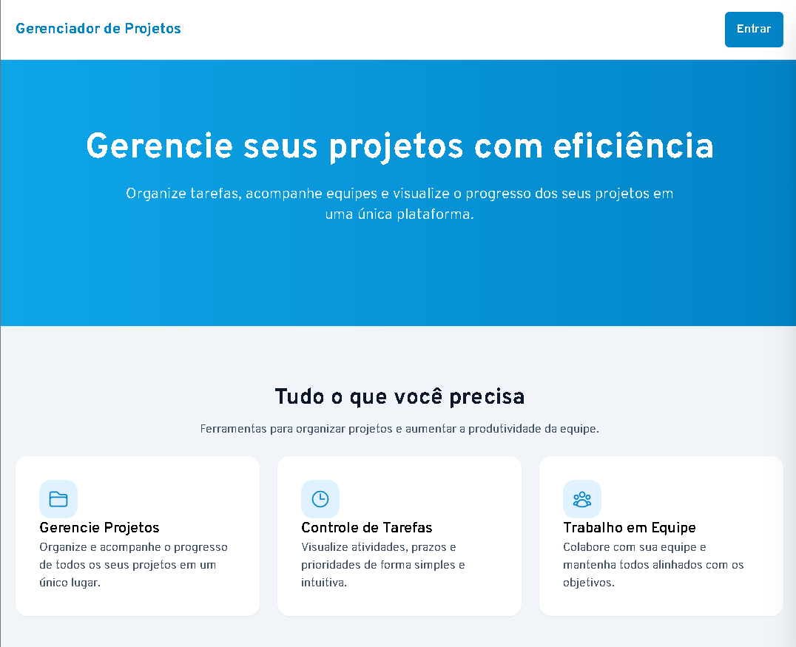
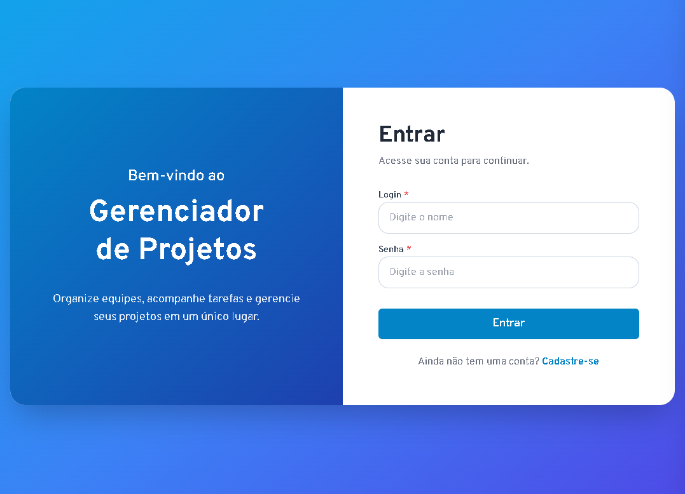
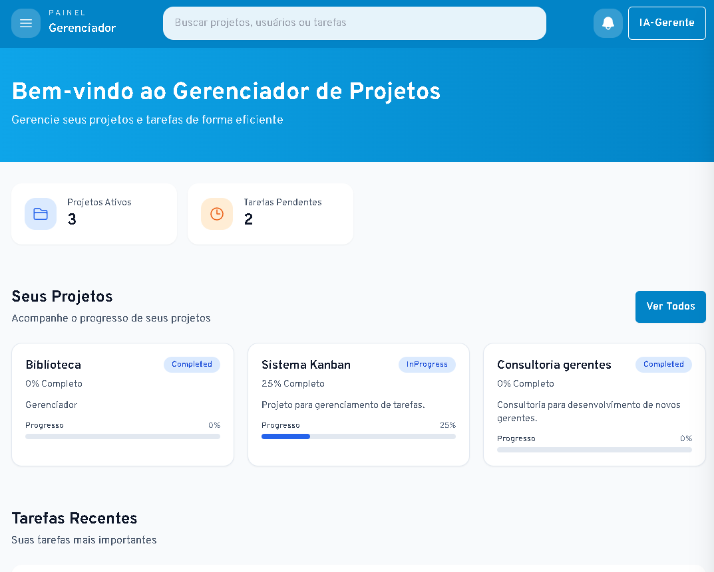

# Gerenciador de Projetos

Aplicação web para organizar projetos, acompanhar tarefas e colaborar com uma equipe. O painel reúne projetos e atividades recentes; dentro de cada projeto, as tarefas podem ser organizadas por sprint e movidas entre etapas em um quadro Kanban.

## Capturas de tela

### Página inicial



### Login



### Painel do usuário



## Recursos

- **Projetos:** consulte projetos, acompanhe o progresso e abra os detalhes de cada um.
- **Quadro Kanban:** organize tarefas nas etapas _A Fazer_, _Em Andamento_, _Em Revisão_ e _Concluído_; arraste cartões para atualizar o status.
- **Sprints:** planeje ciclos de trabalho com período e tarefas.
- **Calendário e painel:** visualize tarefas e prazos, além de acompanhar atividades pendentes.
- **Equipe e configurações:** acesse áreas de colaboração e preferências da conta.
- **Acesso autenticado:** cadastro e login, com páginas internas protegidas.

## Tecnologias

- React 18, TypeScript e Vite
- Tailwind CSS
- React Router
- `@hello-pangea/dnd` para arrastar e soltar tarefas
- Axios para comunicação com a API
- React Calendar e React Big Calendar

## Requisitos

- Node.js e npm
- Uma API compatível configurada para o aplicativo

## Como executar

1. Clone este repositório e entre na pasta do projeto.
2. Instale as dependências:

   ```bash
   npm install
   ```

3. Crie um arquivo `.env` na raiz com a URL da API:

   ```env
   VITE_API_URL=https://endereco-da-sua-api
   ```

4. Inicie o servidor de desenvolvimento:

   ```bash
   npm run dev
   ```

O Vite exibirá no terminal o endereço local para abrir no navegador. Para gerar a versão de produção, execute `npm run build`; para visualizá-la localmente, use `npm run preview`.

## Scripts

| Comando           | Descrição                                |
| ----------------- | ---------------------------------------- |
| `npm run dev`     | Inicia o servidor de desenvolvimento.    |
| `npm run build`   | Gera os arquivos de produção em `dist/`. |
| `npm run preview` | Serve localmente a versão gerada.        |
| `npm run lint`    | Executa o ESLint.                        |

## Páginas

| Caminho                       | Conteúdo                      |
| ----------------------------- | ----------------------------- |
| `/`                           | Página inicial                |
| `/signin` e `/signup`         | Entrar e criar conta          |
| `/home`                       | Painel com projetos e tarefas |
| `/projects` e `/projects/:id` | Lista e detalhes dos projetos |
| `/calendar`                   | Calendário de tarefas         |
| `/team`                       | Área da equipe                |
| `/settings`                   | Configurações da conta        |

As páginas de painel, projetos, calendário, equipe e configurações exigem autenticação.
